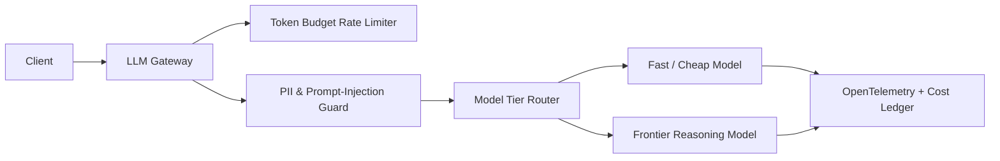

# LLM Gateways, Evals, Agents & FDE Production Playbook

## 1. Production LLM Gateway Architecture

### Reliability & Cost Controls
- **Prompt Prefix Caching**: Keep static system prompts and tool definitions at the front to maximize KV-cache hits.
- **Token-Aware Rate Limiting**: Reserve estimated tokens upfront (`prompt + max_output`), then reconcile actual usage when streaming completes.
- **Structured Outputs**: Enforce JSON schemas at decode time with bounded validation/repair retries.

---

## 2. Layered LLM Evaluation Loop

1. **Golden Dataset**: 50–200 real production edge cases (not synthetic happy paths).
2. **Deterministic Graders First**: Schema validation, unit tests, SQL execution, exact citation checks.
3. **LLM-as-a-Judge Second**: Binary or 1–3 rubric criteria with pairwise swap tests to remove position bias.
4. **Online Monitoring**: Track TTFT, p95 latency, tool-error rate, refusal rate, and user thumbs-up/down drift.

---

## 3. Forward Deployed Engineer (FDE) Deployment Playbook

| Phase | Goal | Safety Mechanism |
| --- | --- | --- |
| **1. Discovery** | Map bottleneck workflow, legacy data systems, and measurable KPI | Written 2-week pilot scope |
| **2. Shadow Mode** | Run AI workflow read-only alongside human operators | Zero side effects; benchmark precision/recall |
| **3. Human-in-the-Loop** | Require operator approval for high-impact writes | Full citation trace + audit log |
| **4. Production** | Automate high-confidence slices | Dead-letter queues, idempotent retries, instant kill switch |
