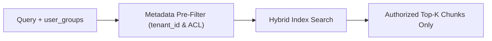

# Production RAG: Hybrid Search, Chunking & Reranking

## 1. Why Naive Vector Search Fails in Production

Pure dense vector similarity handles semantic paraphrasing well, but frequently misses:
- Exact identifiers (error codes like `ERR_CONNECTION_RESET`, SKU numbers, function names)
- Negations and strict metadata constraints (e.g., "docs updated after 2025 for Tenant B")
- Multi-hop facts split across adjacent sections

---

## 2. Hybrid Retrieval + Reciprocal Rank Fusion

Combine **BM25 (sparse lexical search)** with **HNSW dense vector search**, then fuse rankings with Reciprocal Rank Fusion (RRF):

$$\text{RRF}(d) = \sum_{r \in \{\text{BM25}, \text{Dense}\}} \frac{1}{k + \text{rank}_r(d)} \quad (k = 60)$$

Pass the top 30–50 fused candidates into a **Cross-Encoder Reranker** to select the final top 5–8 chunks for the LLM context window.

---

## 3. Security: Pre-Filtered Tenant ACLs

Never post-filter after top-$K$ vector retrieval — doing so can return 0 authorized chunks or leak document existence.

---

## 4. Separating Retrieval vs Generation Evals

| Layer | Core Metrics | How to Fix Failures |
| --- | --- | --- |
| **Retrieval** | Recall@K, MRR, NDCG | Tune chunk boundaries, add hybrid BM25, add query rewriting, upgrade reranker |
| **Generation** | Faithfulness, Citation Accuracy, Answer Relevance | Tighten system prompt grounding, require inline chunk citations, lower temperature |
