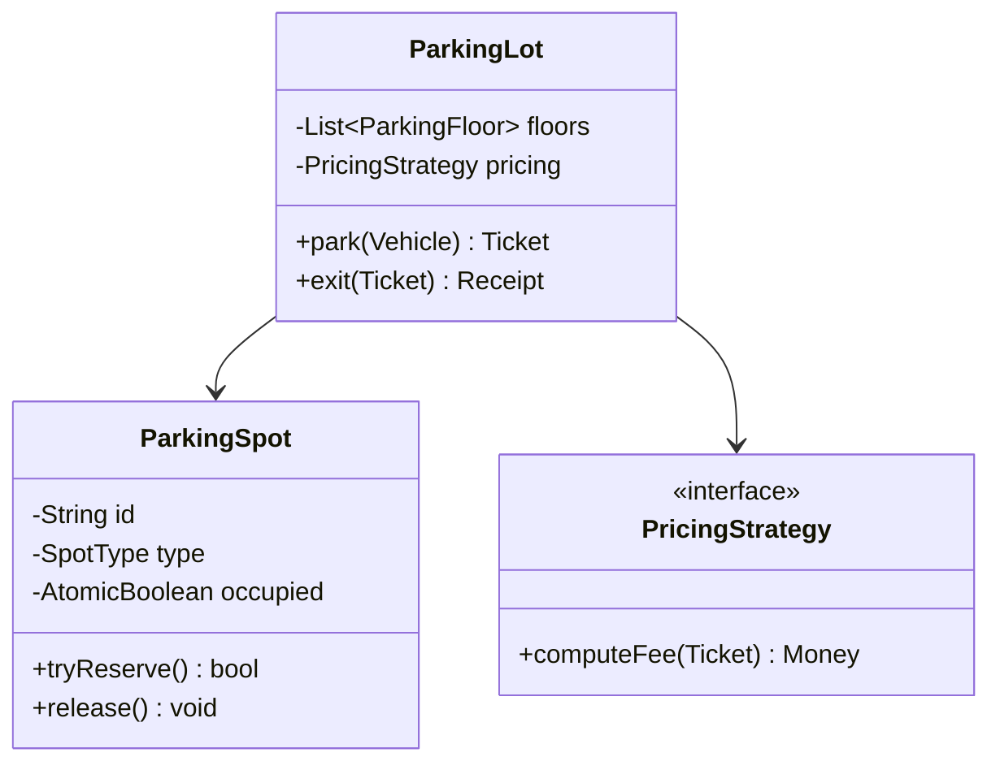

# Low-Level Design (LLD) & OOD Playbook

## 1. The 5-Step LLD Interview Structure

1. **Scope Requirements (5 min)**: Agree on core entities, actors, and 3–4 primary use cases. Explicitly defer out-of-scope features.
2. **Domain Model & Class Diagram (10 min)**: Identify nouns (entities/value objects) and verbs (interfaces/services).
3. **Apply Targeted Patterns (10 min)**: Favor composition over inheritance. Use Strategy for swappable algorithms and State for strict lifecycles.
4. **Concurrency & Invariants (10 min)**: Specify locking granularity (per-entity vs global), optimistic versioning, and idempotency keys.
5. **Code Core Flow & Extensibility (10 min)**: Implement the central service method cleanly and prove how a new requirement plugs in without editing existing classes.

---

## 2. Example: Thread-Safe Parking Lot Class Diagram

---

## 3. SOLID Principles in Practice

| Principle | Practical Interview Signal |
| --- | --- |
| **Single Responsibility** | Separate `TicketRepository` from `PricingStrategy` and `GateController` |
| **Open / Closed** | Add `EVChargingPricing` by implementing `PricingStrategy`, zero `if/else` edits |
| **Liskov Substitution** | Subtypes honor base preconditions/postconditions without throwing `UnsupportedOperation` |
| **Interface Segregation** | Split `ReadableCache` and `EvictableCache` instead of one bloated interface |
| **Dependency Inversion** | Inject `Clock` and `Repository` interfaces for deterministic unit testing |
