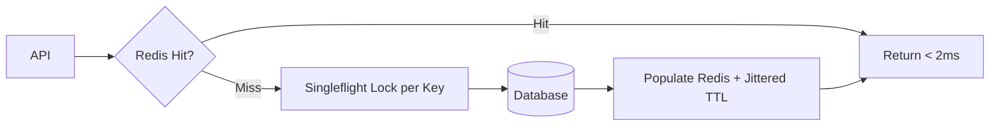

# Distributed System Design Fundamentals

## 1. The 4-Step Interview Framework

1. **Clarify Requirements (5 min)**: Separate functional requirements (core APIs) from non-functional requirements (latency SLO, consistency model, availability target, durability).
2. **Back-of-the-Envelope Estimation (5 min)**: Compute QPS, peak QPS ($2\text{–}3\times$ average), storage growth over 5 years, and network bandwidth.
3. **High-Level Design (15 min)**: Define API contracts, core data schema, and draw the end-to-end request flow.
4. **Deep Dive & Bottlenecks (15 min)**: Address hot keys, partitioning, cache invalidation, replication lag, and graceful degradation.

---

## 2. Latency & Capacity Reference Numbers

| Operation | Typical Latency | Interview Takeaway |
| --- | --- | --- |
| L1 / L2 Cache Reference | $1\text{–}4\text{ ns}$ | CPU-local |
| Main Memory (RAM) | $100\text{ ns}$ | In-memory cache speed |
| NVMe SSD Random Read | $100\text{ }\mu\text{s}$ | Local disk index lookup |
| Same-AZ Network RTT | $0.5\text{ ms}$ | Microservice hop budget |
| Cross-Region RTT (US-East ↔ EU) | $80\text{–}120\text{ ms}$ | Use CDN / regional read replicas |

---

## 3. Core Building Blocks

### Load Balancing (L4 vs L7)
- **L4 (TCP/UDP)**: Routes packets by IP/port without terminating TLS; ultra-low overhead, ideal for WebSocket/gRPC passthrough.
- **L7 (HTTP/HTTPS)**: Inspects paths, headers, and cookies; enables TLS termination, rate limiting, A/B canary routing, and WAF protection.

### Caching Patterns & Stampede Mitigation

- **Cache-Aside**: App checks Redis first, falls back to DB on miss, then writes to Redis with a jittered TTL.
- **Thundering Herd Protection**: Combine request coalescing (singleflight), probabilistic early refresh, and stale-while-revalidate.

### Sharding & Consistent Hashing
- Range sharding risks hot spots on monotonic keys (e.g., timestamps).
- Hash sharding with **consistent hashing + virtual nodes** spreads keys evenly and moves only $\approx \frac{K}{N}$ keys when adding or removing a shard.

---

## 4. Consistency & Replication Trade-Offs

- **Leader-Follower**: Writes go to leader; read replicas scale reads but introduce replication lag (mitigate with read-your-own-writes session tokens).
- **Leaderless (Quorum)**: Configure $W + R > N$ (e.g., $N=3, W=2, R=2$) for strong quorum overlap, paired with hinted handoff and anti-entropy Merkle trees.
