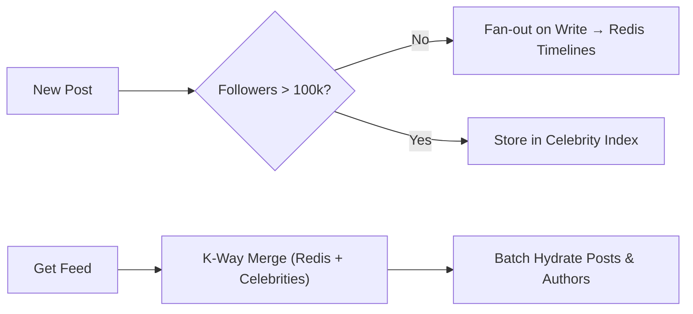

# Social News Feed, Real-Time Chat & Video Streaming

## 1. Social News Feed (Hybrid Fan-out)

- **Cursor Pagination**: Always paginate by monotonic Snowflake `post_id` (`before_id`), never SQL `OFFSET`.
- **Hot-Key Protection**: Replicate hot user timelines across multiple Redis read replicas or local L1 caches with short TTLs.

---

## 2. Real-Time Chat & Collaborative Editing

- **WebSocket Gateways**: Stateful servers terminate WebSockets; a Redis session registry maps `user_id -> gateway_id`.
- **Idempotent Delivery**: Every client message carries a UUID `client_msg_id`; servers deduplicate retries and track `sent -> delivered -> read` ACKs.
- **OT vs CRDT**:
  - **OT (Operational Transformation)**: Centralized server transforms concurrent operations (Google Docs).
  - **CRDTs**: Commutative conflict-free replicated data types (Yjs, Automerge) — ideal for local-first and offline sync.

---

## 3. Video Streaming Pipeline (YouTube / Netflix)

- **Resumable Uploads**: 5–10 MB chunks with SHA-256 checksums.
- **Parallel DAG Transcoding**: Split raw video at GOP boundaries, encode 360p–4K + AV1/H.264 in parallel, output HLS/DASH manifests.
- **Adaptive Bitrate (ABR)**: Client switches bitrate every 2–6s segment based on measured throughput and buffer occupancy.
