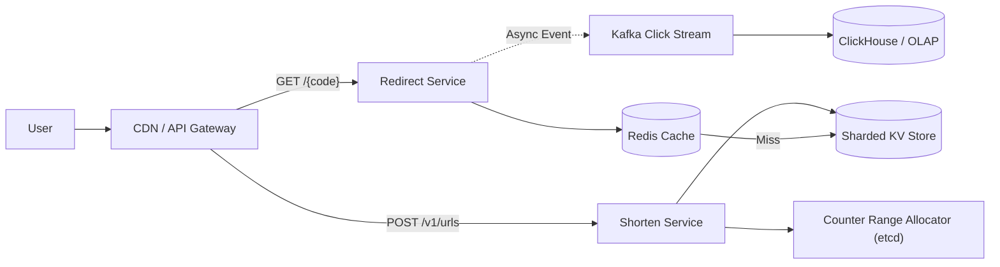

# Design a URL Shortener (TinyURL / Bitly)

## 1. Requirements & Scale Estimates

- **Functional**: Shorten a long URL (`POST /v1/urls`), redirect short code (`GET /{code}`), optional custom alias & TTL expiration, click analytics.
- **Non-Functional**: Redirect p99 $< 20\text{ ms}$, high availability ($99.99\%$), read-heavy ($100:1$ read-to-write ratio).
- **Capacity Math**:
  - $100\text{M}$ new URLs/month $\approx 40\text{ writes/sec}$
  - $100:1$ read ratio $\rightarrow 4{,}000\text{ reads/sec}$ (peak $\approx 10{,}000\text{ QPS}$)
  - $7$-character Base62 code ($[0\text{-}9, a\text{-}z, A\text{-}Z]$) yields $62^7 \approx 3.52 \times 10^{12}$ unique keys.

---

## 2. High-Level Architecture

---

## 3. Key Design Decisions

### 301 vs 302 Redirects
| Status | Browser Behavior | Best Used When |
| --- | --- | --- |
| `301 Moved Permanently` | Browser caches redirect aggressively | Minimizing origin load; analytics not needed |
| `302 Found` | Browser hits origin every click | Accurate click counts, geo, and referrer analytics |

### Collision-Free Key Generation
- **Avoid raw MD5/SHA-256 truncation** alone: collisions require DB existence checks and retry loops.
- **Prefer Counter Range Allocation + Base62**: Each Shorten server leases a block of $10^5$ sequential IDs from `etcd`/ZooKeeper and encodes locally in $O(1)$ with zero DB coordination. Apply a lightweight Feistel permutation if non-sequential codes are required.

### Expiration & Abuse Prevention
- Store `expires_at` on the record; enforce lazily on read (return `410 Gone`) and reclaim storage via an async TTL sweeper.
- Protect `POST /v1/urls` with token-bucket rate limiting and async safe-browsing URL scanning.
